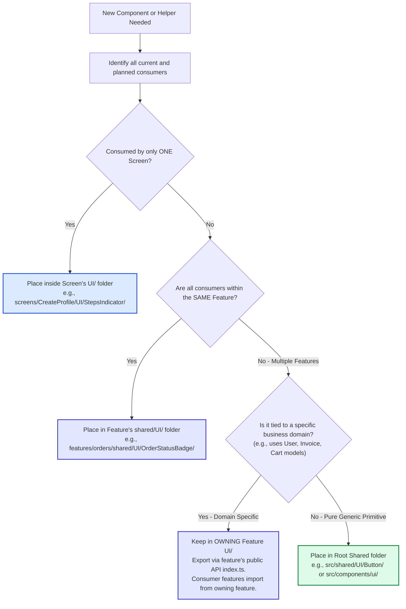
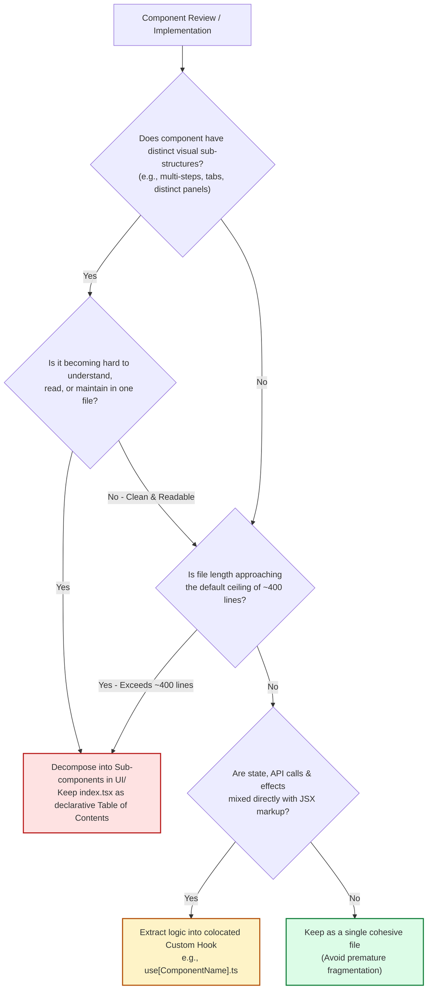

# Decision Trees & Placement Flowcharts

This document provides concrete procedural workflows and decision diagrams for resolving two primary architectural questions:
1. **"Where does this file belong?"** (Lowest Common Ancestor / LCA Placement)
2. **"When should I split this component?"** (Structure & Cognitive Load Driven Decomposition)

---

## Decision Flow 1: Where Does This File Go? (LCA Placement)

Use this flowchart whenever creating a new component, hook, or UI helper to determine its exact filesystem location.

### Step-by-Step Procedure:
1. **Audit Consumers:** List all screens, routes, or features that import this component.
2. **Scan Lowest Common Ancestor (LCA):**
   - If 1 screen consumes it: Colocate inside that screen's folder (`<Screen>/UI/<Component>/`).
   - If 2+ screens within Feature X consume it: Move to `features/X/shared/UI/<Component>/`.
   - If 2+ features consume it:
     - Ask: Does this component belong conceptually to one feature's domain model?
     - **Yes:** Keep it in that owning feature's `UI/` folder and export it in `features/X/index.ts`.
     - **No (Generic UI primitive):** Place in `src/shared/UI/<Component>/`.

---

## Decision Flow 2: When Should I Split This Component?

Splitting components must serve **readability, cognitive clarity, and structural cohesion**, avoiding both monolithic monsters and premature micro-fragmentation.

---

## Quantitative & Qualitative Threshold Matrix

| Criterion | Healthy / Coherent State | Splitting / Refactor Trigger | Action Required |
| :--- | :--- | :--- | :--- |
| **Cognitive Understandability** | Developer understands full layout in < 10 seconds | Hard to follow, mental fatigue reading through markup | Split distinct layout sections into `UI/[SubComponent]/` |
| **UI Structure & Layout** | Single cohesive visual block | Multiple distinct sections (steps, tabs, distinct panels) | Group distinct sections into `UI/[SubComponent]/` |
| **Hard Line-Count Ceiling** | < 300 lines | **Approaching ~400 lines** | Mandatory decomposition into sub-components or hooks |
| **`index.tsx` TOC Quality** | Reads as a clean table of contents (< 60–80 lines) | Clogged with inline markup or deep sub-branches | Move inner layout blocks to `UI/` |
| **Logic / View Mixing** | Custom hook handles state/effects | Raw API calls, effects, and complex state in view | Extract to colocated `use[Component].ts` |
| **Ternary Screen Branches** | 0 – 2 simple visual toggles | `isEdit ? ... : ...` routing/mode branches | Refactor to separate screens + shared form |
| **Consumer Count** | 1 consumer | ≥ 2 consumers | Apply LCA placement algorithm |
